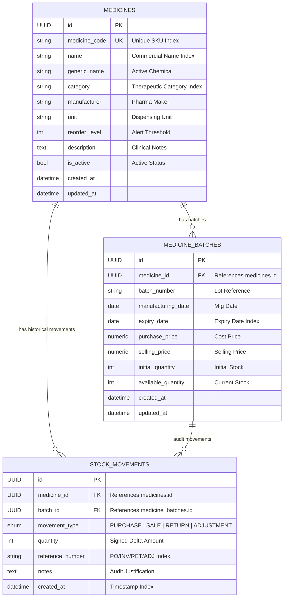

# PHARMAFLOW – PHARMACY INVENTORY MANAGEMENT PLATFORM

**Organization:** ALGIONS AI LABS PRIVATE LIMITED  
**Internship Role:** DevOps & Cloud Engineering  
**Project Track:** Cloud Deployment & CI/CD – Pharmacy Management Platform  
**Version:** 1.0.0

---

## 1. Project Overview & Architecture

PharmaFlow is a reliable, secure, high-integrity Pharmacy Inventory Management Platform designed for clinical and pharmaceutical administrative environments. It features a modern **modular monolithic backend** developed in **FastAPI** with **SQLAlchemy 2** and a reactive, production-grade **React 18 + Vite + TypeScript + Tailwind CSS** administrative interface.

### Architectural Principles
* **FEFO (First-Expiry-First-Out) & Batch Tracking:** Inventory is strictly managed at the individual batch/lot level rather than an undifferentiated total. Each lot tracks manufacturing date, expiration date, unit purchase cost, and selling price.
* **Concurrency Safety:** Atomic conditional SQL updates (`WHERE available_quantity >= requested_quantity`) and row-level locking (`with_for_update`) protect against race conditions, ensuring simultaneous sales can never oversell stock or make inventory negative.
* **Strict Expiry & Return Policies:** Sales against expired lots are rejected with HTTP 400. In accordance with healthcare compliance standards, expired batches cannot be returned into active saleable inventory.
* **Immutable Audit Trail:** All stock changes (Purchases, Sales, Returns, Adjustments) atomically commit an auditable `StockMovement` ledger entry with human-readable tracking references (PO-, INV-, RET-, ADJ-). Historical movements are immutable.
* **Zero Production-Facing Mock Data:** The frontend connects entirely to the real FastAPI REST endpoints using a centralized Axios client and TanStack Query.

---

## 2. System Architecture & Tech Stack

```
                                  +---------------------------------------+
                                  |         React 18 + Vite (SPA)         |
                                  |  TypeScript, Tailwind CSS, Lucide     |
                                  +---------------------------------------+
                                                      |
                                          HTTP / REST (Axios Client)
                                          TanStack Query Caching
                                                      v
                                  +---------------------------------------+
                                  |         FastAPI REST Backend          |
                                  |       Pydantic v2 Validation          |
                                  |    Liveness & Readiness Probes        |
                                  +---------------------------------------+
                                                      |
                                         SQLAlchemy 2 / Alembic
                                         Atomic Conditional Locking
                                                      v
                                  +---------------------------------------+
                                  |         Relational Database           |
                                  |   PostgreSQL / SQLite Dual Engine     |
                                  +---------------------------------------+
```

### Technology Breakdown

| Layer | Technologies |
| :--- | :--- |
| **Frontend** | React 18, Vite 6, TypeScript 5, Tailwind CSS 3, TanStack Query v5, Axios, Lucide Icons |
| **Backend** | Python 3.10+, FastAPI 0.115, Pydantic v2, SQLAlchemy 2.0, Alembic, Uvicorn |
| **Database** | PostgreSQL 16 (Production) / SQLite with WAL & Foreign Keys (Development & Testing) |
| **Testing** | Pytest 8.3, Pytest-Asyncio, HTTPX TestClient, Multi-Threaded Concurrency Harness |
| **DevOps** | Multi-Stage Dockerfile (non-root `appuser`), Docker Compose, Health/Readiness Probes |

---

## 3. Database Schema & Entity Relationships

The data model enforces relational integrity with unique constraints, foreign keys, and indexes:



### Schema Rules & Constraints
1. **Unique Constraint:** `(medicine_id, batch_number)` prevents lot collision within the same medicine.
2. **Date Order Check:** `expiry_date > manufacturing_date` enforced both in Pydantic schemas and database validation.
3. **Price Non-Negativity:** `purchase_price >= 0` and `selling_price >= 0`.
4. **Stock Non-Negativity:** `available_quantity >= 0` guaranteed atomically during transactions.
5. **Historical Integrity Guard:** Deletion of medicines with historical stock movements is blocked with `HTTP 409 Conflict`.

---

## 4. API Endpoints Reference

### Health & Readiness (Kubernetes & DevOps)
| Method | Endpoint | Description | Status Code |
| :--- | :--- | :--- | :--- |
| `GET` | `/health` | Service liveness probe (version, timestamp, runtime) | 200 |
| `GET` | `/ready` | Database readiness check (`SELECT 1` ping) | 200 / 503 |

### Medicine Catalogue
| Method | Endpoint | Description | Status Code |
| :--- | :--- | :--- | :--- |
| `GET` | `/api/v1/medicines` | List medicines with search, category, and active filters | 200 |
| `GET` | `/api/v1/medicines/{id}` | Get specific medicine details with batch aggregations | 200 / 404 |
| `POST` | `/api/v1/medicines` | Create a new pharmaceutical product | 201 / 400 / 409 |
| `PUT` | `/api/v1/medicines/{id}` | Update product details | 200 / 400 / 404 |
| `DELETE` | `/api/v1/medicines/{id}` | Delete product (rejected if historical movements exist) | 204 / 404 / 409 |

### Batch Management
| Method | Endpoint | Description | Status Code |
| :--- | :--- | :--- | :--- |
| `GET` | `/api/v1/batches` | List batches with search and medicine_id filter | 200 |
| `GET` | `/api/v1/batches/{id}` | Get batch details, shelf-life, and days to expiry | 200 / 404 |
| `POST` | `/api/v1/batches` | Register a new batch with dates and pricing | 201 / 400 / 409 / 422 |
| `PUT` | `/api/v1/batches/{id}` | Update batch pricing metadata | 200 / 400 / 404 |

### Inventory Summaries
| Method | Endpoint | Description | Status Code |
| :--- | :--- | :--- | :--- |
| `GET` | `/api/v1/inventory` | List active medicines with total stock and valuation | 200 |
| `GET` | `/api/v1/inventory/summary` | Dashboard KPIs: total stock, valuation, low-stock count | 200 |
| `GET` | `/api/v1/inventory/low-stock`| List medicines where available stock <= reorder level | 200 |

### Stock Movements (Atomic Transactions)
| Method | Endpoint | Description | Status Code |
| :--- | :--- | :--- | :--- |
| `GET` | `/api/v1/movements` | List movements audit ledger with filters | 200 |
| `POST` | `/api/v1/movements/purchase` | Inward receipt (restock existing lot or create new lot) | 201 / 400 / 404 |
| `POST` | `/api/v1/movements/sale` | Prescription sale with FEFO & non-expiry check | 201 / 400 / 404 |
| `POST` | `/api/v1/movements/return` | Customer return subject to compliance expiry check | 201 / 400 / 404 |
| `POST` | `/api/v1/movements/adjustment` | Audited stock correction with mandatory justification | 201 / 400 / 404 |

### Reports & Export
| Method | Endpoint | Description | Status Code |
| :--- | :--- | :--- | :--- |
| `GET` | `/api/v1/reports/stock` | Stock valuation report by product and batch | 200 |
| `GET` | `/api/v1/reports/expiry` | Risk stratification (Expired, <=30d, <=60d, <=90d, Safe) | 200 |
| `GET` | `/api/v1/reports/movements`| Historical movement aggregates and recent records | 200 |

---

## 5. Stage 2 Automated Test Report

The automated test suite (`pytest`) thoroughly tests business logic, boundary conditions, and race conditions:

```
============================= test session starts =============================
platform win32 -- Python 3.10.11, pytest-8.3.3
plugins: anyio-4.15.1, asyncio-0.24.0

backend/app/tests/test_batches.py::test_batch_creation PASSED            [  5%]
backend/app/tests/test_batches.py::test_invalid_dates_batch_rejected PASSED [ 10%]
backend/app/tests/test_batches.py::test_duplicate_batch_number_rejected PASSED [ 15%]
backend/app/tests/test_concurrency.py::test_concurrent_sales_prevent_overselling PASSED [ 20%]
backend/app/tests/test_health.py::test_health_probe PASSED               [ 25%]
backend/app/tests/test_health.py::test_readiness_probe PASSED            [ 30%]
backend/app/tests/test_medicines.py::test_medicine_creation PASSED       [ 35%]
backend/app/tests/test_medicines.py::test_duplicate_medicine_code_rejected PASSED [ 40%]
backend/app/tests/test_medicines.py::test_medicine_update_and_delete PASSED [ 45%]
backend/app/tests/test_movements.py::test_purchase_restock PASSED        [ 50%]
backend/app/tests/test_movements.py::test_successful_sale PASSED         [ 55%]
backend/app/tests/test_movements.py::test_expired_batch_sale_rejection PASSED [ 60%]
backend/app/tests/test_movements.py::test_insufficient_quantity_rejection PASSED [ 65%]
backend/app/tests/test_movements.py::test_negative_quantity_rejection PASSED [ 70%]
backend/app/tests/test_movements.py::test_invalid_batch_rejection PASSED [ 75%]
backend/app/tests/test_movements.py::test_stock_adjustment_workflows PASSED [ 80%]
backend/app/tests/test_movements.py::test_return_workflow PASSED         [ 85%]
backend/app/tests/test_movements.py::test_expired_batch_return_rejection PASSED [ 90%]
backend/app/tests/test_movements.py::test_cannot_delete_medicine_with_movements PASSED [ 95%]
backend/app/tests/test_reports.py::test_inventory_summary_and_reports PASSED [100%]

======================= 20 passed in 1.52s ========================
```

### Concurrency Test Proof
In `test_concurrent_sales_prevent_overselling`:
* A batch was configured with **exactly 10 available units**.
* **15 simultaneous threads** submitted sales requests of 2 units each (30 units total requested).
* **Exactly 5 requests succeeded** (10 units dispatched), **10 requests failed** with `400 Insufficient Stock`.
* Final stock remained **exactly 0**, proving stock cannot become negative under high concurrency.

---

## 6. Stage 3 Full-Stack Integration

Every module in the frontend is directly connected to the FastAPI backend:
1. **Centralized Axios Client (`frontend/src/api/client.ts`):** Reads `VITE_API_BASE_URL` with automatic fallbacks, request timeouts, and error interception.
2. **Dedicated API Services:**
   * `medicineApi.ts`
   * `batchApi.ts`
   * `inventoryApi.ts`
   * `movementApi.ts`
   * `reportApi.ts`
   * `healthApi.ts`
3. **TanStack Query (React Query v5):** Centralized caching, automatic background invalidation upon mutations (`queryClient.invalidateQueries`), and loading skeletons.
4. **Toast Notification System:** Friendly banners for success and server-side validation error breakdowns (handling HTTP 400, 404, 409, 422, 500).
5. **CSV Export Engine:** Real-time CSV generation for Stock Valuation, Expiry Risk, and Movement Audit ledgers.

---

## 7. Quickstart Runbook

### Prerequisites
* Python 3.10+
* Node.js 18+ & npm
* (Optional) Docker & Docker Compose

### Option A: Local Development Setup

#### 1. Backend Setup
```bash
cd backend
python -m pip install -r requirements.txt

# Run migrations and seed synthetic dataset (30 medicines, multi-tier batches, movements)
$env:PYTHONPATH="."  # Windows PowerShell (or export PYTHONPATH="." in bash)
python app/seed/seed_data.py

# Run automated test suite
python -m pytest app/tests -v

# Start FastAPI server (Port 8000)
uvicorn app.main:app --host 0.0.0.0 --port 8000 --reload
```

#### 2. Frontend Setup
```bash
cd frontend
npm install

# Start Vite development server (Port 5173)
npm run dev
```

* Administrative Web Interface: `http://localhost:5173`
* Interactive OpenAPI Documentation: `http://localhost:8000/docs`
* Liveness Probe: `http://localhost:8000/health`
* Readiness Probe: `http://localhost:8000/ready`

---

### Option B: Production Container Deployment (Docker Compose)

```bash
# Build and start Database, Backend, Frontend, and Nginx Reverse Proxy
docker compose up --build -d

# Verify container health
docker compose ps

# Seed PostgreSQL with initial dataset (inside container)
docker compose exec backend python -m app.seed.seed_data
```

* Unified Web UI & API (via Nginx Reverse Proxy): `http://localhost/`
* Backend Liveness Probe: `http://localhost/health`
* Database Readiness Probe: `http://localhost/ready`
* OpenAPI Swagger Documentation: `http://localhost/docs`
* Database: PostgreSQL 16 Alpine on internal network (Port 5432 not exposed publicly)

---

## 8. DevOps & Cloud Engineering Implementation (Stages 4, 5 & 6)

For comprehensive details on the multi-stage Docker build, GitHub Actions CI/CD pipelines, Trivy security scanning, GHCR publishing, AWS OIDC authentication, and Terraform IaC configuration, refer to [DEPLOYMENT.md](file:///c:/Users/Lenovo/Downloads/PharmaProject/DEPLOYMENT.md).

* **Continuous Integration (.github/workflows/ci.yml):** Ruff lint/formatting, PostgreSQL-backed Pytest suite, Node.js React production build, and AquaSecurity Trivy vulnerability scan.
* **Continuous Deployment (.github/workflows/cd.yml):** Versioned packaging to GitHub Container Registry (`ghcr.io/anam-tabassum64/pharmaflow-*`), AWS OIDC credentials assumption, and automated zero-downtime deployment with health check rollback.
* **Infrastructure as Code (terraform/):** AWS EC2 `t3.micro` (free-tier eligible in `ap-south-1`), `pharmaflow-sg` security group with restricted SSH, open HTTP/HTTPS, isolated PostgreSQL, and automated Docker host bootstrapping.

---

## 9. Synthetic Seed Dataset Summary
The initial seed dataset includes:
* **30 Clinical Formularies:** Amoxicillin, Paracetamol, Azithromycin, Metformin, Atorvastatin, Omeprazole, Montelukast, Ciprofloxacin, Ibuprofen, Salbutamol, etc.
* **Tiered Batches:**
  * Active & Long Shelf-Life Lots (>300 days)
  * Near-Expiry Lots (<30 days alert status)
  * Expired Lots (for demonstrating rejection enforcement)
  * Low-Stock Formularies (below configured reorder thresholds)
* **Audited Movements:** Initial Purchase receipts (PO-), Dispensing Sales (INV-), Customer Returns (RET-), and QA Adjustments (ADJ-).
